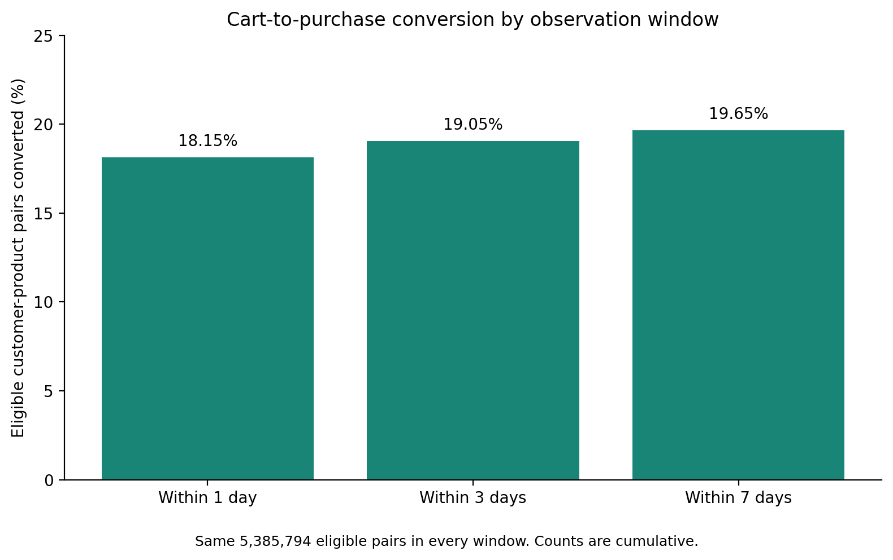

# Retail behavior: cart conversion and repeat purchasing

A customer analytics portfolio project by **Elvin Imanov**, using PostgreSQL and Python to analyze **9,859,619 retail events** from the Synerise dataset.

**Business question:** How often do customers purchase after adding a product to their cart, how quickly does that happen, and how often do observed buyers purchase again within 30 days?

[Read the case study](reports/case_study.md) · [Download the offline dashboard](reports/retail_behavior_dashboard.html) · [Reproduce the analysis](docs/reproduction.md)

GitHub shows the HTML source. Download the dashboard and open it in a browser to view the report. It is a self-contained HTML dashboard, not a Power BI file.

## Results

| Metric | Result | Measurement unit |
|---|---:|---|
| Purchase events | 2,318,502 | Recorded event rows |
| Cart events | 7,541,117 | Recorded event rows |
| 30-day repeat purchase | 14.04% | 103,012 of 733,827 eligible buyers |
| 7-day cart-to-purchase conversion | 19.65% | 1,058,066 of 5,385,794 eligible customer-product pairs |
| Share of 7-day conversions occurring within 24 hours | 92.40% | 977,682 of 1,058,066 converted pairs |

September had the highest monthly cart conversion rate at **21.03%**. November produced the most converted pairs at **266,005**, despite a lower rate of **19.45%**. Rate and volume therefore tell different parts of the story.

These results describe observed behavior. They do not demonstrate incremental sales or measured business improvement.

## Tools and approach

- **PostgreSQL:** CTEs, left joins, conditional aggregation, date arithmetic and reusable views.
- **Python:** PyArrow for Parquet inspection and CSV preparation, pandas for aggregate validation and rate calculations, Matplotlib for visualization.
- **Communication:** an offline HTML dashboard, metric definitions, a short case study and proposed follow-up investigations.

The project uses two event files. It does not use page visits, marketing-channel attribution, campaign spending or an A/B test.

## Metric definitions

**Repeat purchasing:** one row per customer, starting from their first observed purchase date. Eligible customers first purchased on or before November 7, 2022. A return is a purchase on a later calendar day within 30 days. Same-day purchases do not qualify.

**Cart conversion:** one row per customer-product pair, starting from its earliest observed cart event. Eligible pairs entered before December 1, 2022 at 00:00:00. A conversion is a purchase by the same customer of the same product, strictly after that cart timestamp and no later than seven days afterward.

**Timing windows:** one-, three- and seven-day counts are cumulative and use the same eligible pairs. They must not be added together. These windows measure elapsed time, unlike the calendar-day repeat-purchase metric.

**Overall rates:** divide total converted counts by total eligible counts. Do not average monthly percentages.

## Why this matters to marketing

The concentration of conversions within 24 hours suggests that early purchase behavior deserves investigation. It does not establish the best time for a reminder or whether reminders improve conversion. A randomized holdout would be needed to measure incremental campaign impact.

The monthly comparison shows why a team should monitor both conversion efficiency and conversion volume. A lower rate can coexist with more conversions when the eligible audience grows.

## Limits and data decisions

- Events are from **June–December 2022**, although the dataset was used for the RecSys 2025 challenge. It is historical retail data, not current Google Ads or B2B campaign data.
- December 7 is treated as the last complete observation day because December 8 is partial. Timestamp bounds alone do not prove uninterrupted tracking.
- June starts on June 23. The November repeat cohort ends on November 7. These partial cohorts should be labeled when comparing months.
- First observed purchase is not necessarily a customer's first-ever purchase. Purchases outside the dataset are unknown.
- Exact repeated rows were retained because no event or order identifier was available. Counting distinct purchase days and reducing each pair to its earliest qualifying event limits the effect of exact duplicates on these particular metrics.
- Customer-product pairs are not whole carts or orders. An unconverted pair is not proof of cart abandonment. No repeat purchase within 30 days is not proof of churn.
- No monetary revenue or campaign costs were analyzed. ROAS, profit and causal impact cannot be inferred.
- Pairs from the same customer may be dependent. This project reports descriptive rates without claiming independent-observation significance tests.

## Repository map

| Location | Contents |
|---|---|
| `sql/` | Table definitions, analysis views and source-data checks |
| `scripts/` | Parquet preparation and aggregate Python analysis |
| `data/processed/` | Small aggregate result snapshots, no customer identifiers |
| `reports/` | Case study, source validation records, dashboard and chart |
| `docs/reproduction.md` | Setup, import, execution and export steps |
| `docs/interview_notes.md` | Interview explanation and metric questions |
| `docs/cv_bullets.md` | Project wording for the CV |

## Source and provenance

Source: [Synerise RecSys 2025 dataset](https://recsys.synerise.com/data-set). Use the **Synerise dataset** download, not the challenge-preprocessed version. The source describes real retailer interactions and defines the customer, product and event fields.

Raw Parquet and event-level CSV files are not included. Obtain data from the original publisher and follow its applicable terms. This repository does not grant rights to the source dataset.

The aggregate CSV snapshots were reconstructed from the SQL results recorded during project work and reconciled across analyses. To independently verify them, rerun the SQL against the original source files. The original database is local to the project author.

## AI assistance and verification

The project was developed with AI coaching for SQL review and metric interpretation. AI also assisted with the preparation scripts, Python analysis, dashboard and repository documentation. The SQL was run in the author's PostgreSQL database. The packaging step reran aggregate reconciliation and Python chart generation, but did not rerun the full source-data pipeline or PostgreSQL queries.

The portfolio demonstrates the analysis and reasoning the author can explain. It does not claim independent authorship of every line of code or Power BI experience from this deliverable.
